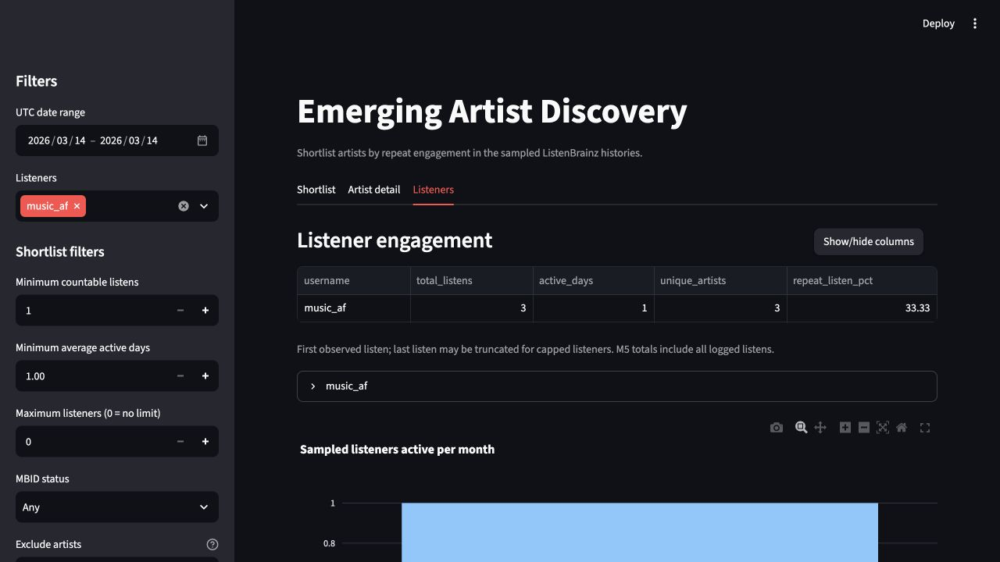

# Module 9 Individual Audit — Lewis

- **Name:** Lewis
- **Audit date:** October 23, 2026
- **Feature:** Listeners tab (UC3): date/listener filtering, empty-state handling, and capped-history labels.
- **Number:** `repeat_listen_pct` in the listener summary, produced by `build_listener_engagement()`.
- **Version checked:** [b67101fbc3d068b5ba42c31992236bdd6bf5ee59](https://github.com/jennzhong/dso576-group-project/commit/b67101fbc3d068b5ba42c31992236bdd6bf5ee59), the App available on `andy-audit` at the start of this audit. `main` did not contain `app.py`. The independent `lewis-module9-audit` branch starts at this version. No application/backend code or data was changed for this audit.
- **Requirement source:** [BUILD_SPEC.md](https://github.com/jennzhong/dso576-group-project/blob/b67101fbc3d068b5ba42c31992236bdd6bf5ee59/BUILD_SPEC.md), especially UC3, Section 3 filter scope and Tab 3, and Section 4.
- **Review status:** AI-assisted draft for Lewis to review before submission. The contribution and AI disclosure below describe who performed the work.

## 1. Intended user and task

The intended user is a music editorial curator or label A&R deciding which listeners provide useful evidence of sustained engagement with lesser-known artists. On the Listeners tab, the curator needs to isolate a listener and UTC period, distinguish exploration from repeated listening, and recognize capped observation histories. A misleading repeat percentage could make a listener who explored different recordings appear more repetitive than the evidence supports.

Date and listener filters should apply to every tab. Shortlist-only controls should not change the listener summary. The default view should cover five listeners, mark H-music, iliekcomputers and s_john_s as capped, and describe the first listen as the first **observed** listen.

## 2. Feature audit: user workflow and results

The unchanged App was run locally with Streamlit. Browser interaction verified selecting `music_af` and a same-day UTC range, then opening the Listeners tab. Streamlit AppTest independently exercised the additional states below. AppTest reads rendered tables and messages; it does not establish that every browser interaction or visual layout works.

| Check / reproducible input | Expected | Actual | Conclusion |
|---|---|---|---|
| Default full period, all listeners | Five listener rows and exactly three capped labels | H-music: 500; iliekcomputers: 500; s_john_s: 500; John V: 226; music_af: 214. The three 500-row users have capped labels. | Pass for this state |
| Remove all listeners except `music_af`; retain full period | One listener; 214 logged listens | One row, 214 listens, 33 active days, first observed 2025-09-17 and last observed 2026-03-25 | Pass |
| `music_af`, UTC start = end = 2026-03-14; open Listeners again if the tab returns to Shortlist | Inclusive single-day selection: 3 listens, 1 active day, 3 artists | Those counts and both observed dates are correct. `repeat_listen_pct` is 33.33, examined separately below. | Filter passes; metric interpretation fails |
| Same single-day selection; set minimum countable listens to 10,000 | Empty shortlist, listener summary unchanged | “No artists match these filters”; listener summary remains 3 listens and 1 active day | Pass: correct scope |
| Choose only a range start (2026-03-14), before choosing an end | Wait for the end date without an exception | `TypeError: Cannot convert input [(datetime.date(2026, 3, 14),)] of type <class 'tuple'> to Timestamp` | Fail: CR-L2 |
| Clear the Listeners selection | No data and no exception | “No listens in this period”; no tables | Pass |
| Select `music_af` and 2019-03-07 through 2019-03-07 | No data and no exception | Same no-data message; no tables | Pass |

The default listener totals sum to 1,940, which is the canonical extract's row count. These are M5 **all logged listens**, not M4's 1,882 countable listens. That distinction is captioned in the App and is intentionally preserved in this audit's denominator. Completed-range filtering is usable in the tested states, but the intermediate one-date range raises an exception (CR-L2), and the repeat metric needs a clearer recording identity definition (CR-L1).

### Partial date-range finding (L-F2 / CR-L2)

The browser test's server log recorded a TypeError after the first calendar click selected 2026-03-14 as the new start, before the second click completed the range. Completing both clicks recovered the App. An AppTest case independently reproduces that intermediate state by setting the date widget value to `(date(2026, 3, 14),)` and rerunning.

`app.py:73-76` unpacks a tuple only when its length is two; otherwise it assigns the entire one-element tuple to both `start` and `end`. That tuple reaches `kpi_analysis._utc_day()` and `pd.Timestamp()` at line 122, causing the exception. Expected behavior is to wait for a complete range (or use a clearly explained provisional single day), rather than pass a tuple where a date is required. This is a feature failure in a normal range-selection transition, even though completed ranges work.

## 3. Number audit: definition, small case, and code assumption

### Meaning and units

For the interpretation “share of logged listens that replay a recording already heard by the same listener within the selected period,” define:

`repeat_listen_pct = 100 × sum(max(listens_for_recording - 1, 0)) / total_logged_listens`

The unit is percent, the expected range is 0–100, and the denominator is all logged listens for that listener in the current UTC range. Each recording contributes one initial listen and any additional listens are repeats. An empty selection should display no metric rather than divide by zero. This is a within-selection metric; it cannot tell whether an earlier play occurred outside the observed/filter window.

**Definition uncertainty:** BUILD_SPEC names `repeat_listen_pct` but does not explicitly define its recording identity key. The audit uses recording identity as the proposed user-facing meaning. If the team intended repetition of title strings, the current arithmetic follows that different definition and the label/documentation should explicitly say so.

### Hand-calculable synthetic case

| Listen | Listener | Artist | Title | Recording identity |
|---|---|---|---|---|
| Jan 1, 10:00 UTC | test_listener | Alpha | Echo | recording-a |
| Jan 1, 10:05 UTC | test_listener | Beta | Echo | recording-b |
| Jan 2, 10:00 UTC | test_listener | Alpha | Echo | recording-a |

There are three listens and two distinct recordings. Only the third play repeats a recording: `1 / 3 × 100 = 33.33%`. The existing function returns **66.67%** because it sees one unique title, then computes `(3 - 1) / 3 × 100`.

### Real-data counterexample and browser reproduction

1. Run `uv run streamlit run app.py` from this branch.
2. In Listeners, keep only `music_af`.
3. Set the UTC date range's start and end to **2026-03-14**.
4. Open the Listeners tab. Scroll the summary horizontally to `repeat_listen_pct`, or use Show/hide columns to retain username, total_listens, active_days, unique_artists and repeat_listen_pct.
5. Observe `music_af`, 3 listens, 1 active day, 3 artists, **33.33** in `repeat_listen_pct`.

The raw canonical CSV contains exactly these three selected rows:

| UTC timestamp on 2026-03-14 | Artist | Title | Recording MSID |
|---|---|---|---|
| 20:56:07 | John Powell | Love Scene | f2dd01d1-242e-4078-ae01-8d7837b6fbc5 |
| 21:01:37 | Armin van Buuren | Extreme Ways | 103a00bb-6d01-4eec-bcab-f61a2cacac4f |
| 21:01:39 | Moby | Extreme Ways | 02e10810-c20f-4bef-92fb-c728042fb641 |

All three also have **different nonmissing recording MBIDs** (included in the JSON evidence). Thus both supplied recording-ID fields distinguish these recordings. All three rows are countable, so excluding double-scrobbles would not explain this discrepancy. Recording-level repeats are `0 / 3 = 0%`; title-level repeats are `(3 - 2) / 3 = 33.33%`. The difference is **33.33 percentage points**.



### Calculation checked

At the audited commit, `member5-aggregations/aggregation_functions.py:57` computes `unique_tracks=('track_name', 'nunique')`. Lines 60–61 subtract that count from `total_listens` and divide by `total_listens`. The hidden assumption is that equal title strings identify the same recording. The two “Extreme Ways” rows disprove that assumption for recording-level repetition. The App displays the backend value without repairing the identity collision.

The independent reference in `lewis_audit_check.py` reads the canonical CSV with Python's standard-library `csv` module and counts recording MSIDs with `collections.Counter`. It does not reuse M5's groupby calculation. The synthetic case is also checkable by hand. For the real counterexample, distinct recording MBIDs corroborate the distinction, so the conclusion does not depend solely on MSID behavior.

As a sensitivity check over each user's full history, title versus MSID definitions give H-music 62.00% vs 60.60%, John V 18.58% vs 18.58%, iliekcomputers 36.00% vs 35.40%, music_af 10.28% vs 7.48%, and s_john_s 15.00% vs 14.40%. These are **identity-definition comparisons, not five verified corrected values**: multiple MSIDs can refer to the same recording MBID. The small counterexample establishes the problem without claiming that MSID is universally correct.

## 4. Findings and requested change

- **L-F1 / CR-L1 (open):** The Listeners repeat percentage uses title-only identity. It overstates recording repetition for the verified same-title/different-recording case.
- **Requested change:** Agree and document whether repetition means a recording or a title. For recording repetition, use a documented stable recording key (for example, recording MBID with an explicit fallback), retain the all-logged-listens denominator unless the contract is deliberately changed, and add collision/regression cases. If title repetition is intentional, rename the displayed metric and explain the title-based rule. Confirm the expected 0% for the real three-row case under the recording definition.
- **L-F2 / CR-L2 (open):** Guard incomplete date ranges before calling `filter_period`. Show a request to choose the end date, or deliberately pass a scalar date under a documented single-day policy. Add a regression check for zero/one/two selected dates. The one-date failure is reproduced; the zero-date state remains untested.
- Lewis's claim and findings were added to `change-requests.md` only on `lewis-module9-audit`. Andy's claims, findings, requested changes and audit code were preserved. No fix was applied to a teammate's backend or App.

## 5. Reproduce the evidence

The following files are committed beside this report:

- [Verification code](https://github.com/jennzhong/dso576-group-project/blob/lewis-module9-audit/lewis_audit_check.py)
- [Inputs, observed outputs, source hashes and runtime versions](https://github.com/jennzhong/dso576-group-project/blob/lewis-module9-audit/lewis-audit-evidence.json)
- [App screenshot](https://github.com/jennzhong/dso576-group-project/blob/lewis-module9-audit/lewis-audit-app-evidence.jpg)
- [Claims and requested change](https://github.com/jennzhong/dso576-group-project/blob/lewis-module9-audit/change-requests.md)

From the repository root, with Python 3.12 and the declared dependencies:

```bash
uv sync --python 3.12
uv run python lewis_audit_check.py > lewis-audit-evidence-rerun.json
uv run python -m pytest -q -rx lewis_audit_check.py
uv run python -m pytest -q tests
```

Observed: **6 passed, 3 xfailed** in Lewis's checks; **23 passed** in the existing `tests/` suite. The three strict xfails are the synthetic/real-data metric failures and the incomplete-range exception described above. They explicitly record the unresolved CR-L1/CR-L2 defects and do not mean the defects are fixed. A future repair will cause an unexpected pass until the xfail marks are removed. Existing tests do not cover this title collision. The runs emitted existing timedelta/empty-median warnings but no unexpected failures.

Runtime used: Python 3.12.14, pandas 2.2.3, Streamlit 1.66.0, Plotly 7.1.0, pytest 9.1.1. Full SHA-256 hashes are in the evidence JSON; the audited `app.py` hash is `8f58e5332081f3a14ba9adbae11a97163e80bc2adac57fe01f569fd2d829b942`.

## 6. Conclusion, uncertainty and individual/AI contribution

The completed-range filtering paths and capped labels satisfy the tested requirements, but selecting only a date-range start raises a TypeError and fails the user workflow (CR-L2). The repeat percentage is mathematically consistent with title-string repetition but is misleading if read as recording-level repetition. The real single-day example demonstrates a concrete difference of 33.33 percentage points. CR-L1 requests an agreed definition and corresponding implementation/label change.

These checks establish the listed UI states, backend outputs, and the recording-identity counterexample. They do not validate all visual states, deployment, mobile behavior, all identity edge cases, every chart, the correctness of the raw listening history, or any inference about wider market trends. A capped sample and non-overlapping listener windows remain important limits. The one-date intermediate range was tested; zero-date states and arbitrary filter combinations were not exhaustively tested.

**Contribution disclosure:** Lewis provided the repository, identified the individual assignment, supplied the name for the report, and required that teammates' portions remain untouched. At Lewis's request, Codex inspected the shared requirements and implementation, selected this separate audit scope, wrote and executed the verification code, operated the local App, assembled the evidence, and drafted this report and Lewis's change request. Andy's row-selection/30-day-return findings were consulted only to avoid duplication and are not claimed here. No independent human execution or final adoption of the judgments is claimed. Lewis should review the metric definition, hand calculation and interpretation, then revise or adopt the conclusions before submitting the report as personal work.
